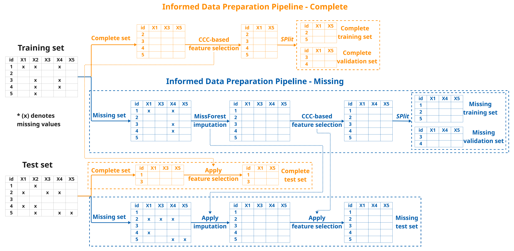

# Auto Machine Learning in Insurance (InsurAutoML)

[](https://github.com/PanyiDong/InsurAutoML/actions/workflows/build.yml) [](https://github.com/PanyiDong/InsurAutoML/actions/workflows/build-windows.yml) [](https://img.shields.io/github/v/release/PanyiDong/InsurAutoML) [](https://codecov.io/gh/PanyiDong/InsurAutoML)

[IRisk Lab](https://asrm.illinois.edu/illinois-risk-lab/illinois-risk-lab-home) Project, UIUC, Fall 2021. It's fully developed and maintained by me.

The project aims to create a AutoML package with special focus on insurance data (with some imbalance in nature). The pipeline is now workable with encoding, imputation, balancing, scaling, feature selection, models (regression, classification models) as pipeline components and model selection/hyperparameter optimization (HPO) process as it's core of connection among all components for tuning. I welcome anyone interested in ML, AI, and AutoML, especially in their intersection with insurance, to explore this project and share ideas or improvements!

## Demo


## Prerequisites

- **Operating system**: Linux (tested on Ubuntu) or Windows (Ray Beta compatibility). The [InformedAutoML](#installation-of-informedautoml) is Linux only (compiled C++ extension).

- **Python** 3.10 or newer (tested on 3.12), with `pip` for the installation (`git` to build from source).

- **Hardware**: the trials run in parallel (Ray Tune), so more CPU threads (and the matching memory) shorten the optimization. A CUDA GPU is recommended for the neural network models (`InsurAutoML[nn]`); on CPU only, they are slow.

- **InformedAutoML**: a C++ compiler with OpenMP and the [`nanoflann`](https://github.com/jlblancoc/nanoflann) headers, see [Installation of InformedAutoML](#installation-of-informedautoml).

- **Web browser**: the [optimization dashboard](https://github.com/PanyiDong/InsurAutoML/blob/master/doc/user_guide.md#optimization-dashboard) (default progress display) opens in a browser on the machine running the optimization (or through an SSH tunnel).

## Installation

> This section installs the InsurAutoML version. For the informed pipelines, see [Installation of InformedAutoML](#installation-of-informedautoml).

### 1. Install from `pip` (recommended)

> The pip version may not be the up-to-date version, use [build from source](#2-build-from-source) for the latest changes.

Open a command terminal.

```console
pip install InsurAutoML
```

**Neural network support** (recommended for `CUDA` supported devices): `pip install "InsurAutoML[nn]"`.

### 2. Build from source

#### 1. Clone the repository

Open a command terminal.

```console
git clone https://github.com/PanyiDong/InsurAutoML.git
cd InsurAutoML
```

#### 2. Install dependencies

#### install by `setup.py`

This method uses `setup.py` to install the package in editable mode with its dependencies.

```console
pip install -e .
```

**Neural network support**: `pip install -e ".[nn]"`.

#### install by `requirements.txt`

> It's recommended to use above `setup.py` to install dependencies as it provides more flexibility to recognize your operating system, compilation issues and some optional packages.

```console
pip install -r requirements.txt
```

`requirements.txt` contains the dependencies of the InformedAutoML version; it does not build the C++ extension of the informed pipelines, see [Installation of InformedAutoML](#installation-of-informedautoml) for that.

For neural network related support (recommended for `CUDA` supported devices), please use `pip install -r requirements_nn.txt`. The pipeline works without any neural network support with the loss of neural network support. If no CUDA device available, please use a non-`torch` environment as those neural network methods can take forever to finish.

## Usage

### 1. Native Python Interface

You can treat it like a package and follows the `scikit-learn` fit/predict workflow like jupyter notebooks in [examples](https://github.com/PanyiDong/InsurAutoML/tree/master/example).

```python
from InsurAutoML import AutoTabular
model = AutoTabular()
model.fit(train_X, train_y)

model.predict(test_X)
```

One important issue I find now is that, `ray.tune` does not force to stop running trials but only stop generating new trials. So, if setting `timeout` too low, it's common the fitting does not end in time (long running trials are expected not to finish in short time). However, if the pipeline is used as normal cases, which the `timeout` and `max_evals` both should be set to a rather large number, this case should not be as significant as very short time limit. I think that force trial runtime to stop can be a solution, but with few tryouts, I haven't found anything useful yet.

#### UPDATE: We have now introduced `InformedAutoML`

`InformedAutoML` proposes more efficient pipeline, Informed Data Preparation Pipeline (IDPP), to _correctly_ perform data preprocessing by utilizing several statistically informed algorithms.



For more efficient deployment,

```python
from InsurAutoML.hpo.informed.fixed import InformedAutoTabular
model = InformedAutoTabular()
model.fit(train_X, train_y)

model.predict(test_X)
```

In the setting, IDPP hyperparameters are fixed, which already provides better predictive capability while achieves significant improvement in computational efficiency. However, users may prefer full tuning, utilizing `InsurAutoML.InformedAutoML`. The `InformedAutoML` shares the same set of arguments as `InsurAutoML`.

##### Installation of InformedAutoML

`InformedAutoML` requires the InformedAutoML version of the package. In addition to the InsurAutoML version, it contains the informed pipelines (`InformedAutoTabular`, `InformedAutoTabularClassifier`, `InformedAutoTabularRegressor`) for data with missing values, and more ML packages and search algorithms (LightGBM, XGBoost, CatBoost, GAM, Optuna, HyperOpt, Nevergrad, FLAML, ...) that allow testing on a larger model/hyperparameter space with different search strategies. Without it, `InsurAutoML` works normally, and using an informed pipeline raises an error showing the installation command.

The informed pipelines need a compiled C++ extension (SPlit), which is only built when the environment variable `INFORMEDAUTOML=1` is set. It requires a C++ compiler with OpenMP and the [`nanoflann`](https://github.com/jlblancoc/nanoflann) headers (e.g. `sudo apt install libnanoflann-dev` or `conda install -c conda-forge nanoflann`), and is not supported on Windows.

Install from `pip` (recommended):

```console
INFORMEDAUTOML=1 pip install "InsurAutoML[informed]"
```

If the InsurAutoML version is already installed, pip keeps it as it is ("Requirement already satisfied"), so also rebuild InsurAutoML with the C++ extension:

```console
INFORMEDAUTOML=1 pip install --force-reinstall --no-deps --no-cache-dir InsurAutoML
```

Or build from source, in the cloned repository (rebuilds the C++ extension every time it is run):

```console
INFORMEDAUTOML=1 pip install -e ".[informed]"
```

Neural network support can be combined as `"InsurAutoML[informed,nn]"`.

More details (Command Line Interface, Optimization dashboard, API Summary) are in the [User Guide](https://github.com/PanyiDong/InsurAutoML/blob/master/doc/user_guide.md).

## Citation

If you use `InsurAutoML` or `InformedAutoML` in your works, please cite our paper using the following BibTex entry:

```
@article{dongAutomatedMachineLearning2025,
  title = {Automated Machine Learning in Insurance},
  author = {Dong, Panyi and Quan, Zhiyu},
  year = {2025},
  month = jan,
  journal = {Insurance: Mathematics and Economics},
  volume = {120},
  pages = {17--41},
  issn = {0167-6687},
  doi = {10.1016/j.insmatheco.2024.10.002}
}

@misc{guoStartingWrongFoot2026,
  title = {Starting {{Off}} on the {{Wrong Foot}}: {{Pitfalls}} in {{Data Preparation}}},
  shorttitle = {Starting {{Off}} on the {{Wrong Foot}}},
  author = {Guo, Jiayi and Dong, Panyi and Quan, Zhiyu},
  year = 2026,
  month = mar,
  number = {arXiv:2603.18190},
  eprint = {2603.18190},
  primaryclass = {stat},
  publisher = {arXiv},
  doi = {10.48550/arXiv.2603.18190},
}
```

## Future

I'm still interested to expand current AutoML package, and have plans to add MLP/RNN structure NAS for NLP tasks (I have a workable algorithm for NAS through nni and it's still in development). I'm aware that some of the code are not written in the most efficient or readable way, as they were developed during my early learning phase with OOP. Due to time constraints, however, a complete code rewrite cannot be promised. Furthermore, I wish to explore the topics in explainability, fairness within the AutoML framework. But no schedules for such progress can be made.
