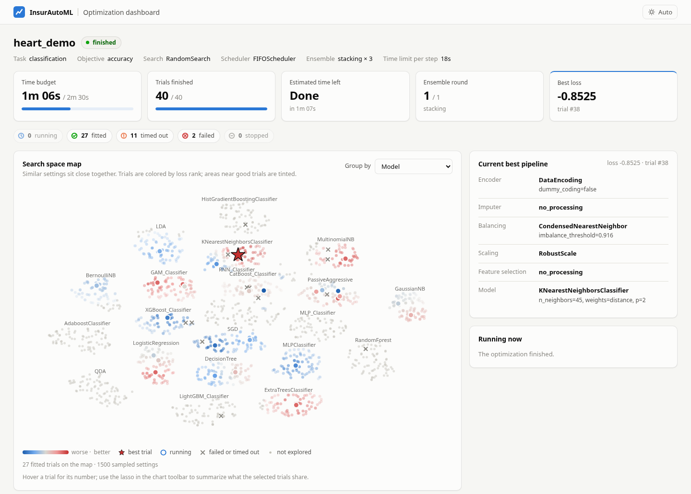

# InsurAutoML User Guide

This guide complements the [README](../README.md) (overview, installation and the Python interface):

1. [Command Line Interface](#command-line-interface)
2. [Optimization dashboard](#optimization-dashboard)
3. [API Summary](#api-summary)
   - [Required packages](#required-packages)
   - [Components](#components)
   - [The pipeline](#the-pipeline)
   - [Customized methods](#customized-methods)
   - [Save and load the models](#save-and-load-the-models)
   - [Configuration](#configuration)
   - [Development](#development)
   - [Other files in the repository](#other-files-in-the-repository)

## Command Line Interface

### Put train/test data in the folder

After putting data to the folder, few of arguments need to be recognized.

__Must have arguments__ :

`train_data` and `response` are two must-have arguments corresponds to training data name (no file extension needed), and response variable name.

Your can specify the data folder (or by default at current folder), test_data name (or evaluation set will be split from train_data), evaluation metrics and all model parameters by arguments.

__Optional arguments__ :

`data_folder`: refers to the folder where the data is stored, default set to current folder.

`test_data`: refers to the test_data file name (no file extension needed), default is to split from `train_data`.

`test_eval`: refers to evaluation metric, default is set to accuracy for classification and MSE for regression tasks.

`n_estimators`: refers to number of pipelines used to form the final ensemble, default set to 5.

`timeout`: refers to the time budget in seconds for experiments, default set to 360.

`max_evals`: refers to number of trials for experiments, default set to 64.

`progress_reporter`: `Dashboard` (default, see [Optimization dashboard](#optimization-dashboard)), `CLIReporter` or `JupyterNotebookReporter`.

Use `python main.py -h` for full list of supported arguments and explanation.

### Run experiments

Example below runs a classification task on `heart.csv` file in `example/example_data` folder

In the command terminal:

```console
python main.py --data_folder example/example_data --train_data heart --response HeartDisease
```

And an example run regression task on `insurance.csv` file in `example/example_data` folder

```console
python main.py --data_folder example/example_data --train_data insurance --response expenses
```

In the end, will see the test evaluation results, recordings of the training procedures and optimal model ensemble file.

## Optimization dashboard

By default, the optimization is tracked in a local web dashboard (instead of the Ray Tune console output). Its address is shown when the fit starts, and again when it finishes (a clickable link in Jupyter notebooks):

```console
[Dashboard] Track the optimization of heart at http://127.0.0.1:8765
...
[Dashboard] Optimization of heart finished, results available (until Python exits) at http://127.0.0.1:8765
```



The dashboard shows:

> 1. progress: time budget, finished trials, estimated time left, ensemble round, and the running/fitted/timed out/failed trials;
>
> 2. a map of the whole search space: sampled settings of every pipeline step and hyperparameter are laid out so that similar settings are close, grouped by model (or by another step). Trials are drawn on the map, warmer colors for better results (rank of the loss), and the area around good trials is tinted. Select trials with the lasso to see what they have in common (methods and hyperparameter ranges);
>
> 3. the current best pipeline, the trials running now, the loss over trials, the loss by method of each step, the trial durations, and a table of all trials (with their errors).

The dashboard runs in the Python process (one per process, a new fit switches it to the new run) and keeps running after the fit until Python exits (`InsurAutoML.dashboard.stop_dashboard()` stops it). It only listens on the local machine; on a remote server, use an SSH tunnel (`ssh -L 8765:127.0.0.1:8765 <server>`).

The trials are recorded in `<temp_directory>/<model_name>/dashboard/events.jsonl`. A finished (or still running) run can be opened again with:

```console
python -m InsurAutoML.dashboard tmp/heart --open
```

Settings:

> 1. `progress_reporter="CLIReporter"` (or `"JupyterNotebookReporter"`): Ray Tune console (notebook) output instead of the dashboard;
>
> 2. environment variables `INSURAUTOML_DASHBOARD_PORT` (default `8765`, the next free port is used if it is taken) and `INSURAUTOML_DASHBOARD_HOST` (default `127.0.0.1`);
>
> 3. `INSURAUTOML_DASHBOARD_SERVER=0`: only record the trials, without the web server.

## API Summary

### Required packages

> InsurAutoML version: numpy, pandas, scipy, scikit-learn, ray[tune], plotly (1), matplotlib, seaborn, gensim, tqdm, tensorboardX, func-timeout, pyarrow, fastparquet, threadpoolctl
>
> InformedAutoML version (`InsurAutoML[informed]`): in addition, lightgbm, xgboost, catboost, pygam, missforest, mlflow and the search algorithms optuna, hyperopt, nevergrad, flaml, bayesian-optimization, and the build dependencies of the C++ extension (pybind11, nanoflann)
>
> Neural network support (`InsurAutoML[nn]`): torch (2)
>
> (1) plotly draws the charts of the [optimization dashboard](#optimization-dashboard) (served locally, works offline).
>
> (2) torch is required for the neural network models (MLP, RNN) and the GAIN imputation; without it, they are left out of the default hyperparameter space.

### Components

> 1. base: load data with some common file format (.csv, .data, etc.) given path into a database dict, and some common utilities
>
> 2. encoding: encoding for categorical/string type to numerical, and can perform dummy coding; category shift
>
> 3. impute for missing values: some of the available methods: Simple Imputer, Miss Forest Imputer, MICE, GAIN, etc.
>
> 4. common scaling methods: Standardize, MinMax Scaling, Winsorization, etc.
>
> 5. deal with imbalance data: use over-/under-sampling methods to balance the dataset, some of the available methods: Tome kLink, One Sided Selection (OSS), Smote, etc.
>
> 6. feature selection: PCA, AFFS, etc. And some models from sklearn will be applied.
>
> 7. apply `ray.tune` (with plentiful search algorithms and search schedulers) to create a pipeline of AutoML workflow. Consider the methods as a hyperparameter, and create a hyperparameter space, where we can find the optimal ML workflow. Only supervised classification/regression models supported.

### The pipeline

> 1. Data Encoding: encode some string type and datetime types to numerical type so it can be more easily handled.
>
> 2. Imputation: impute the missing values in the dataset using supervised/unsupervised learning in case the following processes can not handle NaN values. Will be no_processing if no missing values
>
> 3. Balancing: balance the datasets using under-/over-sampling methods to emphasize the importance of extreme minority class. Will not change the datasets if the datasets are already balanced.
>
> 4. Scaling: scale the datasets to increase the efficiency of convergence, or allows better performance. Can be selected as no_processing.
>
> 5. Feature Selection: remove redundant or insignificant features to improve the performance of the model. Can be selected as no_processing.
>
> 6. Regression/Classification: perform regression/classification models to fit the datasets.

### Customized methods

Customized/personalized preprocessing methods and models are supported by using the `additional.py` file as additional input. In the file, there's also a template of how to write the methods and corresponding hyperparameter space.

### Save and load the models

To save reproduction time, when the optimal model/hyperparameter settings are configured, all settings will be stored as a `model` file (`pickle` file, file name may vary by experiments, controlled by argument `model_name` in Python interface, or `train_data` + "_model" in command line interface). Next time when AutoML pipeline starts training, it will detect whether the `model` file exists and directly use the optimal pipeline, which can save the training time (for optimization). The stored model is only reused when it was fitted on the same data with the same settings (task, objective, ensemble, validation and the methods of the search space); otherwise a warning is shown and the model is fitted again (and replaced). The time and evaluation budgets (`timeout`, `max_evals`) are not compared. Fitted models, preprocessed train/test datasets, hyperparameter settings for each trials will also by stored in `tmp` folders for inspection. (Both `model` and `tmp` are changeable arguments if you prefer other names.) With `delete_temp_after_terminate=True`, only the folder of the run (`tmp/<model_name>`) is deleted, the runs of other models in `tmp` are kept.

The fixed informed pipeline (`InsurAutoML.hpo.informed.fixed.InformedAutoTabular`) stores its preparation pipelines together with its models in the `model_name` file, and takes a `seed` (the same seed gives the same data preparation, feature selection and validation split).

### Configuration

Configuration allowed for `AutoTabular` (`AutoTabularClassifier`, `AutoTabularRegressor`) (only some common arguments here):

> 1. timeout: maximum allowed time for the tuning job.
>
> 2. max_evals: maximum allowed trials for the tuning job. (each trial is trained multiple times, whose training iterations are controlled by limitation time, `timeout` and performance improvements.)
>
> 3. allow_error: maximum allowed failures, as a proportion of max_evals (float) or a number of trials (int)
>
> 4. model_name: saved model names, will be used to recognized for later runs
>
> 5. encoder, imputer, balancing, scaling, feature_selection, models: `auto` (use default methods) or limit as a list of allowed methods.
>
> 6. objective: metrics use to evaluate trials' performance
>
> 7. search_algo: search algorithm, `GridSearch`, `RandomSearch`, `HyperOpt`, `Optuna`, `CFO` and `Nevergrad` are now supported. Default is set to `RandomSearch`. The other search algorithms need their packages, installed with the InformedAutoML version (`InsurAutoML[informed]`) or one by one (see the error message for the installation command).
>
> 8. cpu_threads, use_gpu: computational resources used for the job, will use all available by default
>
> 9. progress_reporter: `Dashboard` (default, local web dashboard, see [Optimization dashboard](#optimization-dashboard)), `CLIReporter` or `JupyterNotebookReporter` (Ray Tune output)

### Development

> 1. formatting and linting: `pip install pre-commit && pre-commit install` runs black and ruff before each commit (the "Format python code" workflow checks them on pull requests);
>
> 2. tests: `pytest tests/` (the tests run in a temporary working directory); the long searches are marked `slow`, `pytest tests/ -m "not slow"` skips them;
>
> 3. `requirements.txt`, `requirements_nn.txt` and `package.json` are generated from `pyproject.toml` with `python setup.py sync` (a build does not modify them).

### Other files in the repository

1. `report.pdf` and presentation slides provides an introduction to the basic idea of AutoML pipeline and demonstrates test performance on some real-life datasets, and `data` provides test datasets in the report.

2. `Dockerfiles` provides a Docker environment preparation files, you can easily build a virtual environment and test your datasets on the AutoML pipeline. The dockerfiles will install necessary packages and clone this repository to workspace.
